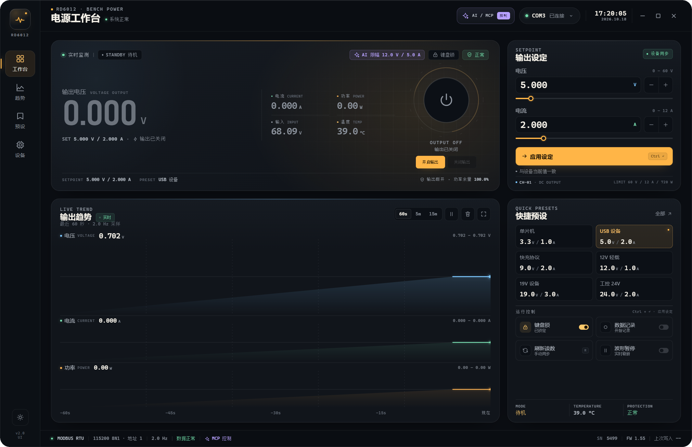
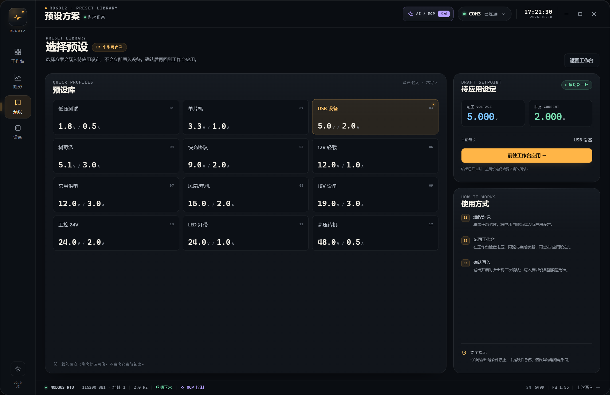
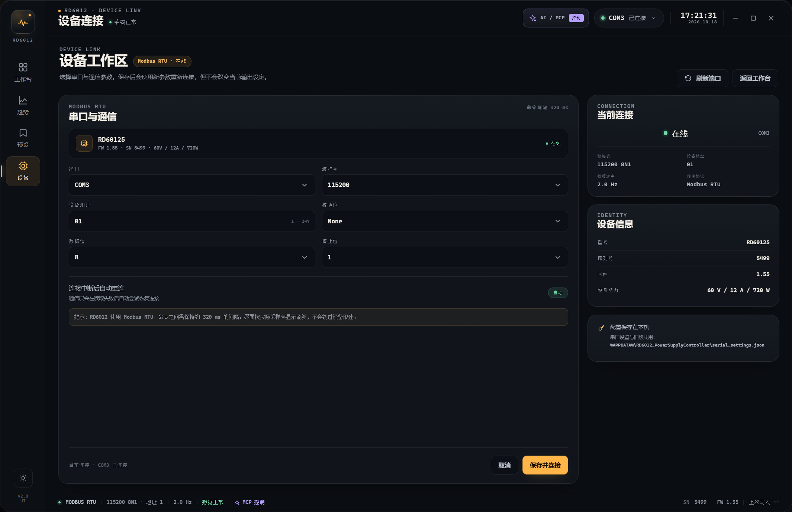
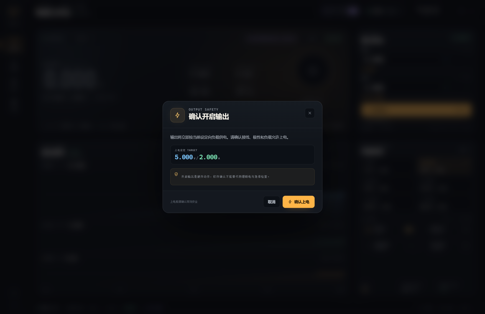
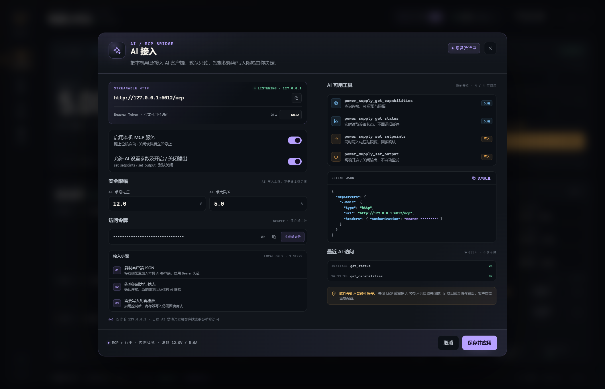

# RD6012 Power Desk

RD6012 Power Desk 是 RD6012 可编程直流电源的新版桌面上位机。界面沿用 `prototype/rd6012-workbench-v2.html` 的暗色仪表视觉，底层直接复用现有 `PowerSupplyController` 的 Modbus RTU、采样、CSV 记录与 MCP 后端。

- 源码：`app/RD6012.PowerDesk/`
- 构建产物：仓库不提交 `release/`，可按下方命令生成，或从 [Releases](https://github.com/EchoTraceX/RD6012/releases) 下载
- 框架依赖发布体积：**约 4.81 MB**（不含 .NET 运行时）
- 旧版应用源码保留在 `app/PowerSupplyController/`

## 技术选型

| 方案 | 结论 |
| --- | --- |
| **C# WPF + WebView2 + HTML/CSS/JS** | **采用**。保留原 Modbus/MCP/CSV 后端，界面直接复用原型；体积小，视觉还原度高 |
| Tauri + Rust | 体积更小，但需要重写串口、MCP、采样、记录层，且本机没有 Rust 工具链 |
| 纯 WPF 重写 | 体积可控，但复杂动效、图表和主题还原成本高，界面会明显偏离原型 |
| Electron | 体积和内存占用明显更大 |

WPF 只负责窗口壳、串口/MCP 生命周期和 WebView2 消息桥；界面全部是 HTML/CSS/JS。

## 运行

### 构建运行

仓库不包含已编译的 `release/` 目录。本地构建：

```powershell
dotnet run --project app/RD6012.PowerDesk
```

或从 [Releases](https://github.com/EchoTraceX/RD6012/releases) 下载框架依赖构建包。

### 运行前提

- Windows 10/11 x64
- .NET 10 Desktop Runtime
- ASP.NET Core Runtime 10（MCP 服务使用 Kestrel）
- Microsoft Edge WebView2 Evergreen Runtime

当前机器已具备以上运行时。框架依赖发布体积小，但换机器时需要安装运行时；若要零依赖分发，可改为 self-contained 发布（体积会增加到约 100 MB 以上）。

### 启动参数

```text
RD6012.PowerDesk.exe --offline    # 不自动连接串口，仍启动 MCP 服务
RD6012.PowerDesk.exe --devtools   # 打开 WebView2 DevTools
```

正常启动时会读取上次串口配置并自动连接；若失败会扫描可用串口寻找 RD6012。串口参数也可以从右上角 `COM` 胶囊或左侧「设备」入口修改。

## 功能

- **四个主视图**：工作台 / 趋势 / 预设 / 设备全部为标签页切换，不再用弹窗承载导航；顶部 `COM` 胶囊和“全部预设”也会切换到对应标签页
- **实时遥测**：电压、电流、功率、输入电压、温度、CV/CC 模式、保护状态、键盘锁
- **输出与设定**：显式「开启输出 / 关闭输出」按钮；上电与输出开启期间的设定写入使用应用内自绘确认弹窗（不再调用浏览器默认 confirm），默认焦点在“取消”
- **记录与波形**：60 秒 / 5 分钟 / 15 分钟实时趋势，暂停、清空、CSV 记录到 `文档\RD6012_Records`
- **串口设置**：端口、波特率、地址、数据位、校验位、停止位；自动发现设备
- **AI / MCP 控制台**：真实启停本地 MCP 服务、真实工具权限与限幅、真实访问审计、令牌管理
- **桌面壳**：无边框窗口、外轮廓与内部 19px R 角一致（不再保留外层方角边框）、可拖拽 / 贴边、自绘最小化/最大化/关闭、窗口位置与大小记忆、跟随 DPI、单实例保护
- **主题**：暗色 / 浅色，记忆在 WebView2 本地存储

### MCP

- 端点：`http://127.0.0.1:6012/mcp`
- 传输：Streamable HTTP + Bearer Token
- 工具：
  - `power_supply_get_capabilities`
  - `power_supply_get_status`
  - `power_supply_set_setpoints`
  - `power_supply_set_output`
- 只监听 `127.0.0.1`；默认只读，允许控制需要显式打开
- 用户限幅默认 `5 V / 0.5 A`，并在 MCP 控制台中可配置，最多到设备能力范围
- 写入需要回读确认，不自动重试；**软件停止不是硬件急停**

MCP 配置和旧版共用 `%APPDATA%\RD6012_PowerSupplyController\mcp_settings.json`，因此旧版中已配置的客户端、端口、令牌和权限会继续生效。串口配置也共用同目录下的 `serial_settings.json`。

## 验证记录

已在真实 RD6012 上完成以下验证：

- 串口 `COM3` 自动连接，实时读取电压/电流/功率/输入电压/温度、CV 模式、键盘锁和保护状态
- WebView2 原生桥：真实快照推送、串口选择、主题切换、最大化/还原、关闭窗口后进程正常退出
- 窗口外轮廓使用 Win32 圆角区域，正常窗口为圆角、最大化时恢复为工作区矩形；缩放/切换 DPI 时同步更新
- MCP 真实握手成功（协议 `2025-06-18`），并通过 HTTP 调用 `power_supply_get_capabilities`、`power_supply_get_status`
- MCP 控制台显示真实服务状态和访问审计
- 离线模式：无设备时数值显示 `--`，设定/输出/记录等写入控件禁用

验证过程中**没有执行任何输出开关或设定写入**，避免影响真实负载。写入工具的代码路径与旧版相同；建议首次使用前先在空载条件下确认。

## 目录

```text
app/RD6012.PowerDesk/
  MainWindow.xaml            WPF 无边框窗口 + WebView2 容器
  MainWindow.xaml.cs         窗口消息桥、MCP 生命周期、串口/输出/记录命令
  App.xaml.cs                单实例保护
  web/index.html             完整界面（HTML/CSS/JS，单文件）
  Assets/AppIcon.ico         应用图标
  preview/                   真实运行截图
  RD6012.PowerDesk.csproj    复用后端源码的链接配置
```

### 消息桥（简要）

页面 → 宿主：`ready`、`serial.connect`、`setpoints.apply`、`output.set`、`lock.set`、`telemetry.refresh`、`recording.start/stop`、`mcp.save/get`、`window.control`、`window.drag`。

宿主 → 页面：`init`、`snapshot`、`mcpState`、`serialPorts`、`windowState`、`recordingState`、`startupConnection`、`response`。

## 构建与发布

```powershell
dotnet build app/RD6012.PowerDesk -c Release

dotnet publish app/RD6012.PowerDesk -c Release -r win-x64 `
  --self-contained false -p:PublishReadyToRun=false `
  -p:DebugType=None -p:DebugSymbols=false `
  -o release/RD6012.PowerDesk
```

## 截图










